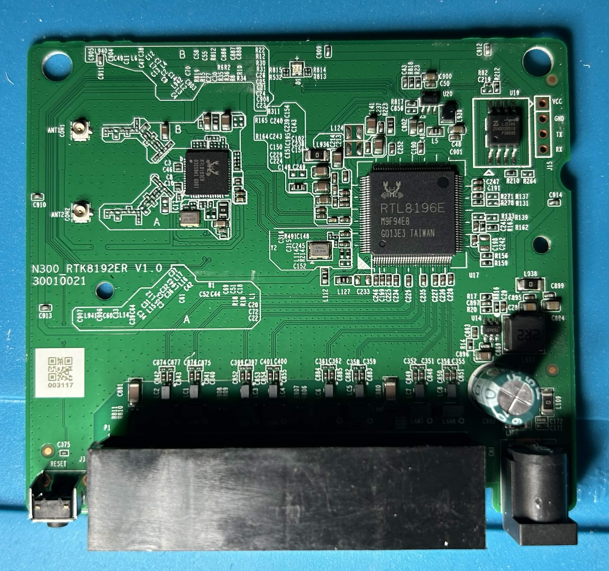
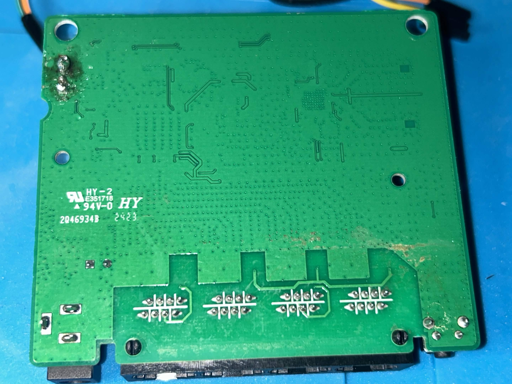

# U-SPEED N300 WiFi Router Teardown

## Version List

- **Firmware:** v1.0
- **RealTek:** v3.4.11E
- **Realtek WLAN driver:** v1.7
- **Linux kernel:** v3.10.9
- **GCC:** v4.6.4 (Realtek RSDK-4.6.4 Build 2080)
- **BusyBox:** v1.13.4
- **Boa:** v0.94

## Board Photo

  

## Identified components

- **PCB:** HY-2 (UL file E351718) 
- **Processor:** RTL8196E M9F94E8 G013E3 TAIWAN
- **RAM:** 24620k/32768k
- **SPI Flash:** LJ2345 25VQ32B3IG P3R095
- **Network Interface Controller:** RTL8192ER 02CS9H1 G007
- **Power Adapter:** 12V ⎓ 0.5A
